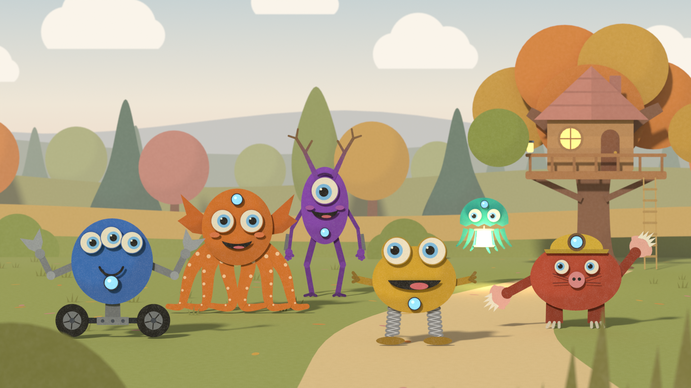
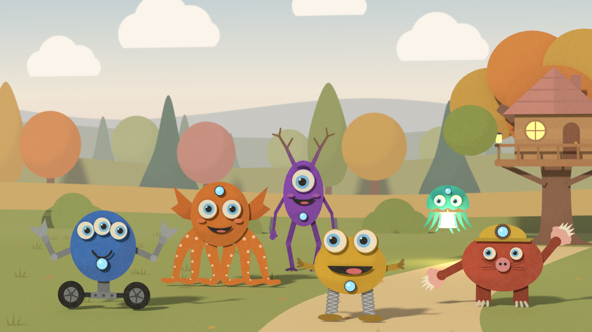
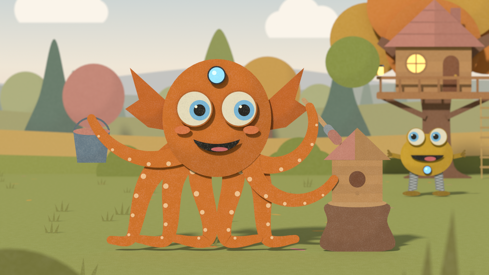
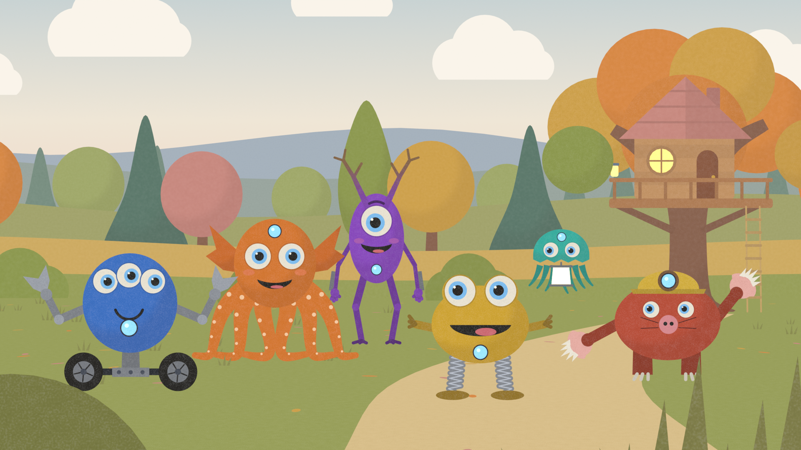
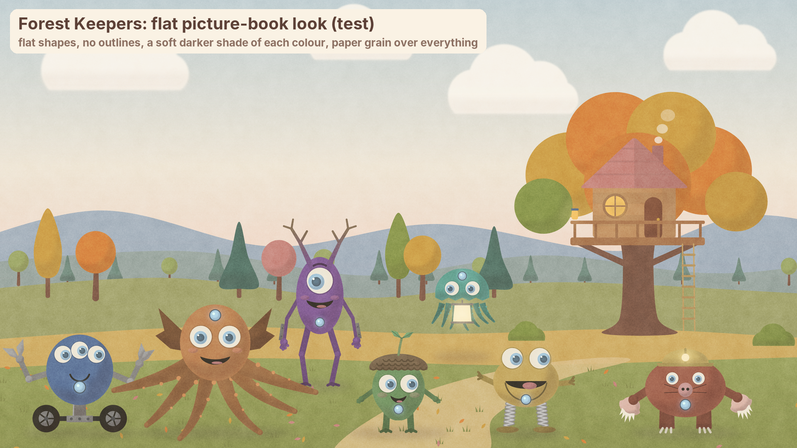

# Forest Keepers in 2.5D: look test (stills)

**Status: experiment, turned down by the owner on 2026-11-16 (see the next section). No render ID, nothing
queued, nothing published.** Made by a Creative
Director side session on 2026-11-16 because the owner asked to see stills of Forest Keepers in 2.5D. Everything
under "Assessment" and "Decisions" is this session's recommendation, not an owner decision.

## Owner's answer (2026-11-16): turned down

The owner looked at the stills and turned the look down, said directly to this session: "I think the 2.5D look is
a bit cursed. I don't like the look of it at all, and I want to go back to the old way of doing it." What he was
hoping for: "more of a use of the space, like the depth of field, where the characters will get smaller to be a
little further back. They always seem to be on the same plane, and that's the only part I really wanted to change,
not their look."

So: **the Keepers' look stays the current flat 2D look, drawn the old way. Nothing in this folder goes further.**
The one thing he wants changed is staging: Keepers standing at different distances, smaller when further back,
instead of all on one line.

What that would mean in the current 2D engine (this session's suggestion, not an owner decision, and not built):

- Give every Keeper a distance as well as an x position. Distance sets three things together: its size (the
  drawing code already takes a size factor, `Monster(kind, k)` in `families/foundry/products/monster.py`), how
  high up the ground its feet stand, and its place in the draw order (far ones painted first).
- Walking toward or away from the camera changes size smoothly with the feet staying on the ground; walking speed
  in pixels scales with size.
- No blur on the far Keepers. Asked whether "depth of field" meant far Keepers slightly blurred or just smaller
  and further back, the owner answered "Just smaller" (2026-11-16).
- Blur is allowed in close-ups where it helps. The owner, same day: "just smaller would be adequate. But if there
  was a close up where a um, bouquet effect or something would be useful, then you can feel free to use some kind
  of blur." I read "bouquet effect" as bokeh, a soft out-of-focus background behind a close-up; that reading is
  mine.
- Checks to add next to storycheck: feet on the ground line for the Keeper's distance, draw order matches
  distance, a hand-over only between Keepers at about the same distance.

I could not make a still of this here: the 2D drawing code needs `skia`, which this laptop does not have. The
Forest Keepers session on the owner's PC can.

## The stills

All 1920x1080. Working copies are in `renders/forest_keepers_25d/` (git-ignored), the copies below are in
`docs/engines/forest_keepers_25d_img/`.

1. `1_clearing_25d.png`: the six Keepers in the clearing by the treehouse, in 2.5D.

   

2. `2_clearing_25d_camera_moved.png`: the same scene, nothing moved except the camera (0.7 m to the right, 0.2 m
   up, turned about 6 degrees). Flip between 1 and 2 to see the depth: the Keepers slide against each other, the
   trees and the hills behind them.

   

3. `3_hans_paints_25d.png`: a closer shot of Hans at work, painting the roof of a birdhouse. Five legs on the
   ground, three tentacles working (two arms and one lifted leg), eight in total.

   

4. `4_clearing_flat_no_depth.png`: the same cut-outs as still 1 with the light, shadows, lens blur and haze all
   switched off. It is there to show what the depth and the light add. **It is not a frame from the current
   production code** (see "The 2D comparison" below).

   

For the real current 2D look, the nearest existing picture is the flat look test the Forest Keepers session made
earlier, already in the repo: `docs/engines/forest_keepers_styles/flat/1_look_test.png` (source: that file;
`docs/engines/forest_keepers.md` records the owner's reaction to it on 2026-11-04 as "looking a lot better").
Still 1 copies its composition on purpose so the two can be put side by side.

## What "2.5D" means here

The owner did not define it. This is the reading the test was built on (the Creative Director session's, passed
to this session in the task): the Keepers and the scenery stay flat drawn artwork, but each piece is a paper
cut-out standing at its own depth in a real 3D space, on a real ground, seen through a real camera. That gives:

- parallax when the camera moves (stills 1 and 2);
- soft shadows cast by one cut-out onto the ground and onto the cut-outs behind it;
- lens blur on the near layers (the bush and grass at the bottom edge) and the far layers (hills, far trees);
- haze: far layers fade toward the sky colour;
- one light across everything (a warm sun from the top left, soft sky light in the shadows, plus a small warm
  light at Glo's lantern that falls on the path).

It is a paper theatre, not 3D models. The Keepers have no thickness.

## What was built

One script, `experiments/forest_keepers_25d/keepers_25d.py`, run with Blender 5.3 and nothing else:

    blender -b -P experiments/forest_keepers_25d/keepers_25d.py -- --shot clearing --res 1920x1080 --samples 64
    (shots: clearing, shift, work; add --flat for still 4)

- **The Keepers are redrawn, not reused.** The production drawing code (`families/keepers/illustrate.py`,
  `families/keepers/flat.py`, `families/foundry/products/monster.py`) imports `skia` and `cv2`. Blender's Python
  on this laptop has neither (checked by importing them: both fail; only numpy is there), and the task ruled out
  installing anything. So each Keeper was rebuilt as flat shapes from the numbers in `monster.py`: the same
  body sizes, eye positions, part sizes and colours, in the same units, with the flat look's colour softening
  (`mute`, 0.12) and its one soft darker shade per shape. The scenery (hills, trees, treehouse, palette) is
  rebuilt the same way from `flat.py`.
- **Each Keeper is a small stack of paper layers**: limbs at the back, body 2 cm in front of them, face 2 cm in
  front of the body. Hans' legs each sit at a slightly different depth.
- **The treehouse is taken apart into layers**: crown masses behind, trunk, cabin, roof standing proud of the
  cabin, porch in front, two crown masses in front of the porch ends.
- **The ground is a real floor**, not a painted band. The Keepers stand on it at different distances from the
  camera (between 6 and 10 metres in still 1) and their shadows fall on it.
- **Limbs cannot stretch.** An arm or leg is built from bones of a set length taken from `monster.py`, and a
  tentacle is a curve of a set arc length. A tentacle asked to reach something further away than its own length
  stops the script instead of stretching. The script prints every limb it drew. From the final renders' log
  (`renders/forest_keepers_25d/final.log`), in monster units: Hans' five or six planted legs 274.9 each, his
  three working tentacles 275.0 each; Twigs' arms 92.3 and 80.6, legs 114.0 and 113.8; Wheels' arms 76.2 and
  67.1; Springs' arms 47.0; Digs' arms 95.0. The same lengths in every still.
- **Nothing passes through anything.** Feet, wheels and tentacle undersides rest on the floor (an early test had
  the undersides of Hans' feet 2 cm inside the ground; fixed). The brush tip is on the roof slope, the steadying
  tentacle's tip is on the birdhouse wall, the pot hangs from the tentacle that holds it.
- Still 3 follows the owner's Hans rules in `forest_keepers.md` (8 tentacles in total, a third working tentacle
  is a leg that lifts; several tentacles working together).

## Render times

Measured on this laptop (Intel i7-1255U, no graphics card, Cycles on the CPU, 64 samples with denoising), from
the render log. Another Blender render may have been using the CPU at the same time, so these may be on the slow
side; I did not check.

| Still | Render time |
|---|---|
| 1 clearing | 192 s |
| 2 clearing, camera moved | 168 s |
| 3 Hans paints | 175 s |
| 4 flat comparison (no light, no blur) | 54 s |

Building the scene takes about 10 more seconds each time (from the Blender log's timestamps).

At about 3 minutes a frame, a 3 minute episode would be 5,400 frames at 30 frames a second, so around 270
hours on this laptop (my arithmetic from the times above; twice that at 60). That is not
workable as it stands. See "What does not work".

## Assessment (this session's opinion)

What works:

- **They are still the Forest Keepers.** Same six, same colours, same shapes. Next to the 2D look test the
  difference is the depth, not the characters.
- **The ground does a lot.** A shadow under each Keeper pins it to the ground, and a Keeper further back is
  visibly further back. Glo floating reads as floating because his shadow is separate from him.
- **Depth is real, so some old faults cannot happen by accident.** What is behind is behind for the whole shot
  because it is behind in space, not because of a draw order someone has to get right. A wall would be a thing
  with a position; walking "through" it would mean walking into it, which a simple distance check can catch.
- **The camera can move.** Stills 1 and 2 are one scene. A slow push-in or drift costs nothing extra to set up,
  and it suits the slow, calm pacing rule.
- **The fixed-length limbs.** This is the part that answers the top complaint, and it does not depend on 2.5D:
  the same rule (a tentacle is a set length, a reach that is too far is refused, not stretched) could go into the
  2D engine. `forest_keepers.md` currently allows working tentacles up to 2x their length.

What does not work, or is not shown:

- **Stills prove nothing about motion.** Stretching limbs, warping and walking through walls are animation
  faults. These stills show a look and a way of building poses; they do not show a walk, a turn or a handover.
- **Turning is the hard problem and it is untouched.** A paper cut-out has one side. The owner already rejected
  an animal that "is obviously paper thin" when it turned (`forest_keepers.md`, storycheck `paper_thin`), and
  asked for Keepers that turn to walk. In 2.5D a turn still has to be drawn (swap the artwork for a
  three-quarter view) exactly as in 2D. A camera that swings too far round would also show the flatness; in
  still 2 it moved 0.7 m and that is about as far as I would take it.
- **It looks more like cut paper or felt than the flat look the owner picked.** The small shadows between a
  Keeper's own layers (under the eyes, under the face) and the visible grain give a craft-table feel. The owner
  chose "flat, no outlines" over the cut-paper option on 2026-11-04 (source: `forest_keepers.md`). Those inner
  shadows can be switched off, keeping only the shadows on the ground and between separate things.
- **It is a redraw, so details differ from production.** Hans' head sits a little lower so his planted legs
  splay; the soft shade is an approximation; the grain is generated differently; Twigs' brow, the mouths and
  Digs' paws are close copies, not the same code. Hans' two middle legs lie on top of each other on the ground
  and read as a loop. A production version would use the real drawing code.
- **Render time.** See above. Cheaper routes exist in principle (render each layer once and slide the layers,
  or Blender's faster engine), but I tested neither and do not know whether the faster engine runs on a machine
  with no graphics card.
- **It is a different pipeline.** The Forest Keepers engine, its checks (`storycheck.py`, `causecheck.py`) and
  every episode are 2D drawing code. Moving to this is either a rewrite, or a hybrid where the existing code
  draws each Keeper and prop as a picture with a transparent background and Blender only arranges, lights and
  films them. The hybrid needs `skia` on the machine that renders; whether the owner's PC setup can do that is
  unknown to me.
- **The owner has turned down 3D once.** `forest_keepers.md` records that a Blender 3D look test was not
  approved (2026-11-03/04) and that he asked for "a two dimensional planar space, utilizing layered background
  elements to create depth". I read this test as inside that sentence, but real light and cast shadows go
  further than he has seen, and he may not agree.

Verdict: as a look it holds up and adds real depth without changing who the Keepers are. It does not by itself
fix the animation faults; the fixed-length limb rule does, and that rule is separable from 2.5D. I would not
commit an episode to this on the strength of stills.

## Decisions for the owner

1. Is this the 2.5D he meant, and does he like it better than the flat 2D look test?
2. Keep the small paper shadows inside each Keeper, or keep each Keeper perfectly flat and only cast shadows
   on the ground and on other things?
3. If he likes it: the next step I would suggest is a 10 second motion test (a short walk and Hans working)
   before anything else, since motion is where the complaints are. That needs a decision on which machine
   renders it.
4. Separately from the look: should the "limbs never stretch, a reach that is too far is refused" rule go into
   the current 2D engine now? That would be a change to an owner-approved rule (tentacles at most 2x).

## Files

- `experiments/forest_keepers_25d/keepers_25d.py`: the whole test.
- `docs/engines/forest_keepers_25d_img/`: the four stills.
- `renders/forest_keepers_25d/`: working renders and `final.log` (git-ignored).
