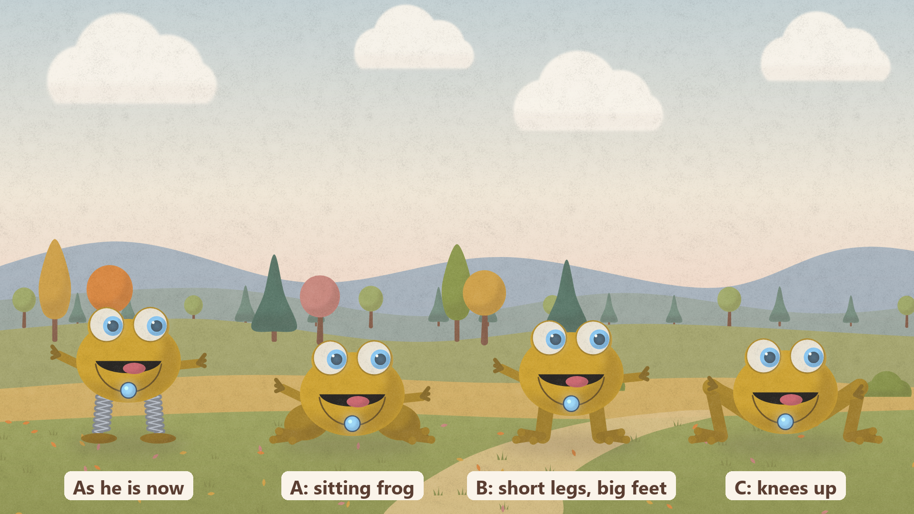
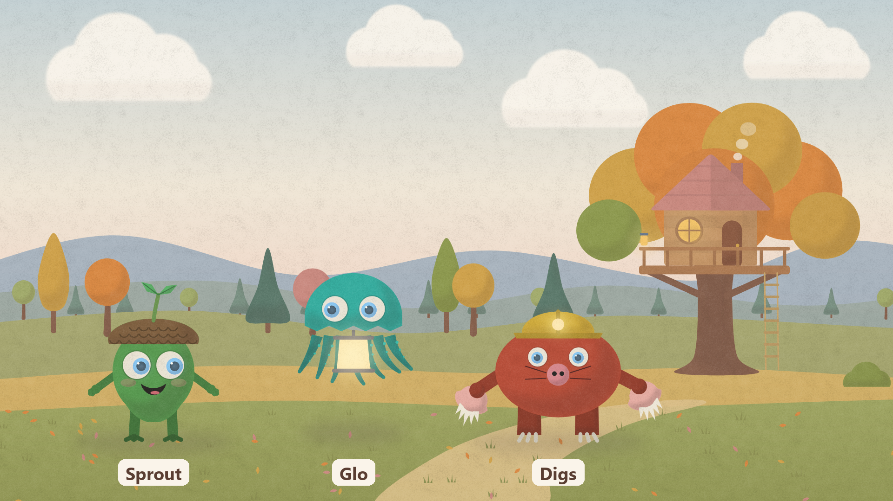
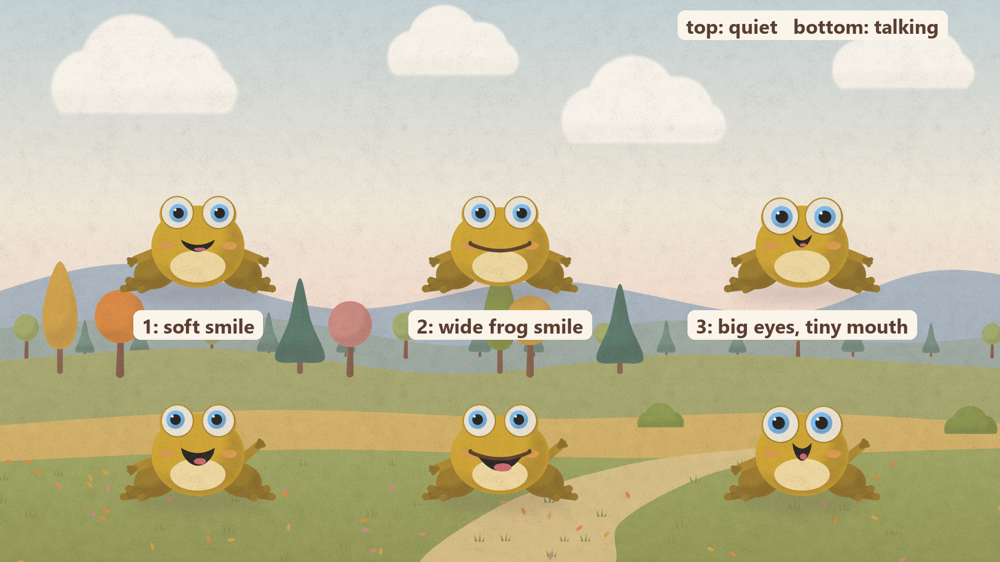

# Forest Keepers: the talking format (proposal and owner's direction)

Written by the Creative Director session, 2026-11-17. The section "Owner's direction" is what the owner said to
this session that day, in his words or close to them. Everything else is this session's proposal: **not approved,
nothing built, nothing rendered, no voices generated.**

## Why

The owner on 2026-11-17, about the 16 minute acorn-flour and bread remake: "mostly AI slop", the physics "isn't
obeyed at all", and the music's key was changed without asking him. His decision the same day: "remake this a bit
from the ground up... give each of the characters their own voice... focus more on dialogue and less on motion and
building, and try and lean into the strong suits... softer, gentler, animal-based and cute characters... The
movement will be limited, like just going from place to place and not doing so much action."

## Owner's direction (2026-11-17)

- **Voices:** every Keeper gets its own voice. They "should sound like children or even a fictional character
  voice". The narrator stays, "but she should speak a little slower".
- **Cast:**
  - Wheels and Twigs "can go".
  - Melody "probably needs to go too since she isn't based on a living thing".
  - Hans "can be someone they see in the water in a special episode or two".
  - Blossom "is a keeper but her origin hasn't happened yet".
  - "Glo is fine."
  - Springs "is fine but maybe could lose the springs legs and get something more frog like but still super cute".
  - Sprout and Digs: he did not mention them. This session assumes they stay (an acorn seedling and a mole); to
    confirm.
- **Stories:** a mix of little feelings stories and gentle nature facts, "with a goal of a lesson relevant to
  children in each story and something they can relate to".
- **Formats:** both. "Shorts build subs, longs get watch hours."
- **Length:** "I still want 8+ minute longs to be the norm but I want some shorter proofs that show a spoken
  narrative can work and that you can still do movements that are less complicated to avoid breaking physics."
- **Staging** (2026-11-16, `forest_keepers_25d.md`): the flat 2D look stays; Keepers stand at different distances
  and are smaller when further back; no blur, except a soft background behind a close-up where it helps.
- **Music:** nothing about the music changes without asking him first.

## Proposed rules of the format (this session)

What is allowed to move:
- mouths (open and close with the voice), eyes, blinks, eyelids, a head tilt, a small bounce;
- Blossom's flower, Glo's lantern brightness, fireflies, leaves, water ripples;
- going from place to place in short bursts: Sprout and Digs walk, Glo and Blossom float, Springs hops;
- one Keeper may hold one small thing, already in its hand when the shot starts.

What is not in the format:
- building, digging, cutting, carrying between characters, hand-overs, tools meeting materials;
- anything picked up or put down on screen;
- Hans' tentacles doing work.

A scene change is a cut to a new place, with everyone's position kept consistent.

## Three short proofs (proposed)

Each proves one thing, so a failure says what failed.

1. **Proof A, about 40 s: voices and faces only.** Sprout and Glo on the porch at night. Nobody travels. Proves
   the voices, the mouths, the eye lines and the slower narrator.
2. **Proof B, about 60 s: place to place.** Springs hops from the porch to the pond, Sprout walks after him in a
   short burst, they talk at the water's edge. Proves simple travel and the smaller-when-further staging.
3. **Proof C, about 90 s: a whole small story with a lesson.** Three voices and the narrator, two places, one
   cut. This is one chapter of a long episode.

### Script for Proof A: "The Dark Is Just the Day, Resting"

Lesson: being scared of the dark is normal, and it helps to say so to a friend.

*Porch at night. Sprout sits with wide eyes. Glo floats beside him, lantern bright.*

**Narrator:** It was bedtime in the forest. But one little Keeper was wide awake.
**Glo:** Sprout? You keep looking at my lantern.
**Sprout:** I like it on. When it's on, I can see where everything is.
**Glo:** And when it's off?
**Sprout:** Then I think about what I can't see.
**Glo:** I used to do that too. Want to know my trick? I turn it down slowly. Like this.

*The lantern dims a little. Sprout's eyes follow it. Fireflies show up as it gets darker.*

**Sprout:** Oh... there are little lights I couldn't see before.
**Glo:** They were always there. The dark just lets you see them.
**Narrator:** And Sprout found out that the dark is just the day, resting.

*The theme plays, in its usual key. Hold.*

### Script outline for Proof B: "Springs Is Too Fast"

Lesson: waiting for a friend who is slower than you.

Springs hops ahead to the pond and calls back. Sprout walks, small and far away, getting bigger as he arrives.
Springs is impatient, then notices Sprout stopped to look at a snail. Sprout: "You went past it." Springs hops back,
slowly this time, and they look together.

### Script outline for Proof C: "Digs Doesn't Want to Share His Hill"

Lesson: sharing something you love does not use it up.

Porch: Digs tells Glo he found the best hill for watching the sunset and he is not telling anyone. Cut to the hill:
Digs alone, sunset, and it is too quiet. Glo and Sprout float and walk up from far away. Digs moves over. Narrator
closes.

## How an 8+ minute long is built from this (proposed)

Five or six chapters of about 90 seconds, each in a different place (porch, pond, hill, hollow log, meadow, back
to the porch), one story and one lesson across all of them, the narrator linking the chapters, the theme at the
start and the end. The travel between places is a cut, not a long walk (owner's short-walking-bursts rule in
`forest_keepers.md`). Shorts are cut from single chapters, re-framed upright.

## What has to happen before any proof is built

1. **Voice samples.** Two or three candidate voices per character (Sprout, Glo, Springs, Digs) and the narrator at
   a slower pace, for the owner to pick. This uses ElevenLabs credits, so it needs his go-ahead. Never the biology
   voice (Lindsay), per `CLAUDE.md`.
2. **Springs' frog legs.** A look sheet for the owner to approve before he appears in Proof B.
3. **Cast confirmation** for Sprout and Digs.
4. **Who builds it.** The 2D drawing code needs `skia`, which the Creative Director's laptop does not have, so the
   Forest Keepers session on the owner's PC would build the proofs. That goes through Local Operations.

## Voice auditions, round 1 (2026-11-17, waiting for the owner's picks)

The owner said "go ahead and make the samples" and asked this session to handle the prototyping, then hand back to
the Forest Keepers session. Script: `experiments/forest_keepers_talk/voice_samples.py`. Files (git-ignored):
`renders/forest_keepers_talk/voices/`. All are ElevenLabs library voices on model `eleven_v4`, each character's
candidates reading the same line. Credits: the account counter went from 207,551 to 208,287 used (of 241,000),
so about 740 for the round, tests included.

| Character | A | B | C |
|---|---|---|---|
| Sprout | Teddy Twinkle (cute cartoon boy) | Austin (timid young boy) | Candy (young, sweet, high) |
| Glo | Veda Sky (whimsical kids' narrator) | Jessica (playful, bright, warm) | Milly (cheerful Australian character) |
| Springs | Fergy Frog (sweet frog companion) | Little Dude II (high, mischievous) | Moxy (happy cartoon mouse) |
| Digs | Georgee (goofy cartoon) | Jasper (gentle and cautious) | Teddy Twinkle again, for comparison |
| Narrator (Johanna) | as the episodes have her now | older model at speed 0.72 | as now, with pauses written into the line |

The descriptions are the voice library's own words, not this session's judgment: this session cannot listen to
audio, so nobody has heard these yet.

**Finding about the narrator's speed.** The Keepers narrator config (`narration/keepers_voice.yaml`) asks for speed
0.88 on model `eleven_v4`. In a test on one line, `eleven_v4` returned a take of exactly the same length at speed
1.0, 0.8 and 0.72 (76,529 bytes each, about 4.8 s). So that setting has probably never slowed her down; this is
inferred from one line, not checked against a finished episode. On `eleven_multilingual_v2` the setting does work
(3.9 s at 1.0, 4.9 s at 0.8, 5.5 s at 0.72), but that is an older model and she may sound different. Writing
pauses into the text on `eleven_v4` gave 6.0 s. Narrator samples B and C are those two ways of slowing her.

## Voice auditions, round 2 (2026-11-17, waiting for the owner's picks)

The owner's answers to round 1: Sprout "show me more like A, teddy could work but i want more comps"; Glo "these
are all adults, no good"; Springs and Digs "show me a with 2 more like a"; narrator "show me johanna at 0.92 and
0.84". Listening page: `renders/forest_keepers_talk/voices/listen_round2.html` (git-ignored; voice ids in
`round2.json` beside it).

| Character | Candidates |
|---|---|
| Sprout | A Teddy Twinkle (kept), D Valf (very young, playful), E Kavya (childlike wonder), F Sammy (sweet, quirky), G Heli (helium character voice) |
| Glo | D Munni (animated kid), E Lulu Lolipop (high cartoon girl), F Folly Willowmere (whispery fairy), G Piku (expressive kid; library lists an Indian accent) |
| Springs | A Fergy Frog (kept), D Freddie Flip (gentle little frog), E Miffy Mouse (squeaky; library lists British) |
| Digs | A Georgee (kept), D Ziggy (goofy, high), E Bello Buff (young eager dog) |
| Narrator | Johanna at 0.92 and at 0.84, both on `eleven_multilingual_v2`, the model where the speed setting works |

"More like A" for Springs and Digs came from ElevenLabs' similar-voices search on the round 1 sample plus keyword
searches; the similar-voices results for Digs were mostly adult women, so his two are keyword picks.

## The cast's voices: owner's picks (2026-11-17)

His words: "lulu lollipop is definitely the winner for glo. fergy frog wins for springs. georgee wins for digs. I
think Johanna at 0.88 will be good (half between .84 and .92). kavya for sprout."

| Character | Voice | Note |
|---|---|---|
| Glo | Lulu Lolipop | |
| Springs | Fergy Frog | |
| Digs | Georgee | |
| Sprout | Kavya | |
| Narrator | Johanna, speed 0.88 | on `eleven_multilingual_v2`: the samples he chose between were made on it, and on `eleven_v4` the speed setting did nothing in our test |

Voice ids and settings: `experiments/forest_keepers_talk/cast_voices.yaml`. For the hand-back to the Forest Keepers
session: `narration/keepers_voice.yaml` still says `eleven_v4`; this session has not changed it.

## Proof A, voices only (2026-11-17, waiting for the owner to listen)

`experiments/forest_keepers_talk/proof_a_audio.py` voices the Proof A script with the picked voices and lays the
lines end to end with pauses: `renders/forest_keepers_talk/proof_a/proof_a_voices.mp3`, 43.8 s, with line timings
in `proof_a_cues.json` (for mouth movement later). No picture and no music yet. Nobody has listened to it: this
session cannot hear audio.

## Proof A, with picture (2026-11-17, waiting for the owner's verdict)

The owner on the voice track: the characters "all sound great together", the narrator at 0.88 "sounds perfect"
once she was voiced in one take (see below), and "proof sounds good". He also cleared installs on the laptop
("you're okay to install anything you want"), so Python 3.12 and the project's drawing packages are now in `.venv`
there and the real Forest Keepers drawing code runs on it.

- File: `renders/forest_keepers_talk/proof_a/proof_a_the_dark_is_just_the_day_resting.mp4` (1920x1080, 30 frames a
  second, 46.4 s, git-ignored). Script: `experiments/forest_keepers_talk/proof_a.py`. Render: 1,147 s on six cores.
- Picture: the real flat look (night meadow from `night_flat_world.py`, Keepers from `illustrate.figure`), a closer
  shot than the episodes (scenery drawn 1.3x, Keepers drawn at that size directly).
- What moves: Sprout's mouth follows the loudness of his own voice; Glo has no mouth and talks with her lantern,
  as in the episodes; eyes on each other; Glo's lantern dims after "Like this."; fireflies come out; Sprout looks
  up and lifts one arm (a fixed-length arm) toward them. Sprout is nearer and bigger, Glo further back and smaller.
- Nothing is picked up, carried or built, and nobody travels.
- **Music** (owner 2026-11-17: "Yes, add the music"): `proof_a_music.py` renders the original theme,
  `VARIANTS[None]` in `families/keepers/music.py` (C major, 104 beats a minute, 19 bars here, no notes folded), with
  the bed and reverb `families/keepers/scene.py` uses, and lays the voices over it the way the narrated episodes
  do: voices 1 dB above the music, music down 6 dB while someone speaks (measured as RMS here, not LUFS). The
  other entries in `VARIANTS` move the tune 2 to 7 semitones and slow it, which is how the key came to change;
  the proof does not use them. File: `proof_a_the_dark_is_just_the_day_resting_with_music.mp4` (same picture,
  new sound; the first file without music is kept beside it).
- **Music level, round 2** (owner 2026-11-17 on the first mix: "slightly too loud... start fading it down sooner.
  And fade it up slower. Because it was getting too loud between lines. And they really should only be getting loud
  during periods of silence, like when they're doing motion or a montage... It doesn't need to come up very quickly
  between every line of story. But as far as the key, I like it where it's at."). Now: the music stays down for
  a whole conversation (a gap between lines under 4 s does not bring it up), starts down 1.8 s before the first
  word, comes back up over 4 s and only in a real silence, sits 9 dB down while down (was 6), and the voices are
  2 dB above its full level (was 1). In Proof A that means down from the start to 43.9 s, rising only at the end.
  **The key stays as it is: C major, the original theme.**
- Checked by this session on contact sheets cut from the finished file: the mouth opens and closes during
  Sprout's lines, the lantern dims, the arm lifts and comes back down. Not checked: how it feels in motion, and
  whether mouth and voice feel in step. This session cannot watch video or hear audio.

**Narrator pacing rule (found the hard way).** Voiced one short line at a time, Johanna sped up: the closing line
alone came out at 170 to 195 words a minute on eight different seeds, and the owner heard that as "trying to win a
speed reading contest". The same lines voiced together in one take came out at about 157 words a minute, which he
called "perfect". So the narrator's lines for a scene are voiced in one request and cut apart afterwards using the
character timings the service returns (`proof_a_audio.py`).

## Proof B, in preparation (2026-11-17)

The owner on Proof A's second music mix: "Yes, on to Proof B". Two things are with him before it is built.

**1. Springs' frog legs.** Look sheet: `forest_keepers_talk_img/springs_frog_legs.png`, drawn by
`experiments/forest_keepers_talk/springs_frog_sheet.py` (the production drawing code is untouched: his spring legs
are left off and the frog legs drawn behind his body). Options: A sitting frog (folded thighs, feet out to the
sides), B short legs with big webbed feet, C knees up. Known flaw on the sheet: in C the knees sit where his arms
are.

**Owner's answer (2026-11-17): "A, but also his head and mouth need a rework to be more cute. Remove the orb,
remove the orb from all of them."** So:

- Springs gets frog legs A (sitting frog).
- **No orbs on any Keeper.** `experiments/forest_keepers_talk/cast.py` (`no_orbs()`, `figure()`) draws the cast from
  the production code with the orbs off: Sprout without his tummy socket, Glo without the orb on her dome, Digs in
  his plain hard hat with its little lamp. Sheet: `forest_keepers_talk_img/cast_no_orbs.png`. The production code
  (`monster.py`) is not changed; that is for the hand-back. Proof A was rendered before this and still shows orbs.

  

- Springs' head and mouth, three options (`cast.frog_springs`, `forest_keepers_talk_img/springs_frog_faces.png`),
  each shown quiet and talking, all with frog legs A, a pale tummy, soft cheeks and no orb: 1 a soft smile, 2 a
  wide frog smile (one long curve), 3 bigger eyes and a tiny mouth. Waiting for his pick.

  

**2. The script, "Springs Is Too Fast"** (about 60 s; lesson: waiting for a friend who is slower than you).

*The meadow path by the pond, daytime. Springs is at the water's edge, near us. Sprout is far back up the path,
small.*

**Narrator:** Springs could hop to the pond faster than anyone.
**Springs:** Come on, Sprout! The pond is right here!
*Sprout walks a few steps toward us and stops. He is looking down at something in the grass.*
**Springs:** Sprout? Why did you stop?
**Sprout:** There's a snail. You went right past it.
**Springs:** A snail? I didn't see any snail.
**Sprout:** That's because you were hopping. Come and look.
*Springs hops back up the path, two small hops, getting smaller as he goes, and lands beside Sprout.*
**Springs:** Oh... it has a little house on its back!
**Sprout:** It takes it everywhere. Slowly.
**Springs:** I think I'll walk the rest of the way with you.
**Narrator:** And the pond was still there when they arrived. It always is.

What it tests: a hop along the path away from the camera and a short walk toward it, both changing size with
distance (the owner's smaller-when-further staging); two voices and the narrator; music up during the hop (a real
silence) and down under the talk. Nothing is picked up: the snail stays on the ground.

## Proof B, built (2026-11-17, waiting for the owner's verdict)

The owner picked Springs' face 2 (the wide frog smile). Built with `experiments/forest_keepers_talk/proof_b.py`.

- File: `renders/forest_keepers_talk/proof_b/proof_b_springs_is_too_fast_with_music.mp4` (1920x1080, 30 frames a
  second, 50.5 s; the version without music is beside it).
- Staging change from the script above: the pond is at the far end of the path and Springs starts there, so he
  hops TOWARD the camera to reach Sprout and the snail. A flat Keeper going away from the camera would travel
  backwards. Sprout starts at the near left and walks across to the snail. The lines are unchanged.
- Distance: one rule, `scale_at(y)`: a Keeper's size comes from how far up the meadow its feet are. Springs goes
  from 0.42 of full size at the pond to 0.90 beside the snail over four hops.
- Sprout's walk: `flat_motion.biped` on planted feet with `stance_drop`, turned to walk, arms hanging and swinging,
  3.4 s at the owner's pace for his size. Springs' hops: feet stay put while he crouches (0.42 s), the hop carries
  him (0.58 s), he lands where the next one starts.
- A cut to a closer shot (1.9x) for the talk at the snail; everyone is exactly where the wide shot left them.
- No orbs. Springs is the sitting frog (`cast.frog_springs`, face 2).
- Music by the owner's rule: down under the three stretches of talk (0.5 to 8.4 s, 13.0 to 26.2 s, 31.6 to 48.0 s),
  coming up slowly in the two real silences, Sprout's walk and Springs' hops. Original theme, C major.
- Narrator: at speed 0.88 her two lines came out at 183 words a minute, so the script re-made the take at 0.76,
  which measured 155. It now does that by itself (`NARRATOR_WPM = 157`, within 5).
- Checked by this session on contact sheets from the finished file: Sprout's feet alternate and he turns to walk
  and back; Springs is bigger on each landing; the cut lands with the three in the same places. Not checked: how
  the walk and hops feel in motion. This session cannot watch video or hear audio.

**Owner on Proof B (2026-11-17): "Yeah, I really like it. The only thing that's weird is Johanna. Her voice sounds
deeper for some reason. The pace is still good, but the voice sounds deep."**

Measured, not heard: her pitch was the same (205 Hz median in Proof B against 202 Hz in Proof A), but the take was
darker: 59 % of its energy below 300 Hz against 46 % in Proof A. The difference between the two was the speed
setting: Proof B's first take was made at 0.76 to hit the pace, Proof A's at 0.88. An audition sample at 0.78
measured dark as well (65 %). So a lower speed setting slows her and darkens her. Inferred from three takes of
different sentences, so not proven, but consistent.

**Narrator rule now:** always voice Johanna at 0.88 on `eleven_multilingual_v2`, in one take per scene, then slow
each of her lines to about 157 words a minute with a pitch-preserving stretch (ffmpeg `atempo`; `proof_b.py`
`mix()`). Proof B was redone that way without re-rendering the picture: the new 0.88 take measured 52 % below 300
Hz, its lines came out at 174 and 190 words a minute and were slowed by 0.86 and 0.85 to the lengths the picture
was timed to. Same file name as before.

## Owner's notes on Proof B, second listen (2026-11-17), and what changed

- "the mouthing of the words for Sprout, it seems like he's just a millisecond behind... probably like a quarter of
  a second or something like that, maybe even a tenth." Mouths follow the loudness of the voice and Sprout's words
  start softly, so his mouth opened late. Each mouth now moves a little ahead of the sound (`proof_b.LEAD`: Sprout
  0.17 s, Digs 0.08 s, Springs 0.05 s).
- "the mouthing for Springs is good, but when he shuts his mouth or just opens it a little bit, his tongue opens
  first... his tongue is stuck on the outside of his closed mouth." His tongue now shows only when the mouth is open
  wide enough to hold it and sits inside the opening (`cast.frog_springs`).
- "I still think her voice is a little too deep." Six more takes at the approved setting measured 52 to 69 % of
  their energy below 300 Hz (Proof A's: 46 %); none matched, and the measurement did not explain what he heard. So
  he compared six narrator-only versions by ear: "1 and 6 both sound okay. 2, 3, 4, and 5 are all terrible." 1 was
  Proof A's take; 6 was Proof B's lines on `eleven_v4`, the model the episodes use, slowed to pace; 2 to 5 were the
  `eleven_multilingual_v2` take as it was, with less bass, pitched up, and both.

**Narrator rule, final for now:** Johanna on `eleven_v4`, one take per scene, each line then slowed to about 157
words a minute with a pitch-preserving stretch. No speed setting (it does nothing on v4). This replaces the two
earlier narrator rules in this note. `narration/keepers_voice.yaml` already uses `eleven_v4`; what the episodes
were missing is the slowing step, since its `speed: 0.88` never took effect.

## Proof C, built (2026-11-17, waiting for the owner's verdict)

The owner: "Yes, do Proof C". Built with `experiments/forest_keepers_talk/proof_c.py`; he had not seen the script
before it was voiced.

- File: `renders/forest_keepers_talk/proof_c/proof_c_digs_doesnt_want_to_share_his_hill_with_music.mp4`
  (1920x1080, 30 frames a second, 79.9 s; picture render 720 s on six cores).
- Script (lesson: sharing something you love does not use it up):
  - Narrator: Digs had found something wonderful. And he did not want to tell anyone.
  - Glo: Digs, where do you go every evening? / Digs: Nowhere. Just... a hill. / Glo: A hill?
  - Digs: The best hill. You can see the whole sunset from it. But it's mine. If everybody comes, there won't be
    any left for me. / Glo: Oh. Okay, Digs. *(Digs walks off; cut)*
  - Narrator: So Digs watched the sunset by himself. It was beautiful. And it was very, very quiet.
  - Digs: It's a really good one tonight. And nobody saw it but me. *(Sprout walks up and Glo floats up)*
  - Sprout: Digs! We were looking for you! / Digs: Do you want to see something? *(he steps aside)*
  - Glo: Ohhh. Look at all the colors! / Sprout: It's the whole sky! / Digs: It's even better with you here.
  - Narrator: And Digs found out that a sunset doesn't get smaller when you share it. It gets bigger.
- Two places, one cut (a soft dip through cream): the meadow by the treehouse, then a hilltop at sunset drawn for
  this proof (sunset sky, a sun that sinks slowly, far hills, evening light over everything).
- Movement: Digs' walk off and his step aside (`flat_motion.biped`, planted feet, arms hanging); Sprout walks up the
  hill and Glo floats up from further back, growing from about 0.6 to 0.9 of full size by the one distance rule.
- Voices: Digs is Georgee, Glo is Lulu Lolipop, Sprout is Kavya. Mouth leads and Springs' tongue fix as above. No
  orbs; Digs wears his plain hard hat with its lamp.
- Narrator by the new rule (`eleven_v4`, slowed to pace). **Caution:** on these lines her takes measured 67 to 71 %
  of their energy below 300 Hz on six seeds, against 47 % for Proof B's lines on the same model. That measure did
  not predict the owner's ear before, so it may mean nothing, but she may sound deeper here.
- Music by the owner's rule: down under the three stretches of talk, up slowly during Digs' walk off and the cut,
  and while his friends come up the hill.
- Proof B was given the same narrator rule (47 % on that measure) and re-rendered with the mouth and tongue fixes;
  same file name as before.
- Checked by this session on a contact sheet from the finished file: both places, the cut, the friends arriving
  smaller then bigger, Digs one step to the right at the end. Not checked: motion and sound.

## Owner's notes on Proof C and the re-rendered Proof B (2026-11-17), and what changed

- "Johanna sounds good again in both proof B and proof C." The narrator rule stands.
- Proof C: "every time Johanna talks and the characters are going to start talking after her, she gets cut off
  mid-word. It happens twice." Cause: her one long take was cut into lines on the service's character timings, and
  on `eleven_v4` those were about 0.3 s off (they said 5.44 to 5.60 s where the real pause was centred on 5.11 s).
  Now each cut is made in the middle of the real pause between two lines, found from the sound itself
  (`proof_b.narrator_bounds`). **Never cut her on the service's timings.**
- Mouths, both proofs: "you can still hear them after their mouth is done moving." Two causes: a mouth that led
  the sound also stopped that much before the end of its line (a mistake in the time-window test), and every mouth
  shut the moment the loudness dropped. Now (`proof_b.mouth`): a mouth runs to the end of its line's sound and
  closes slowly; leads are small (Sprout 0.08 s, Springs 0.04 s, Digs 0).
- Digs' hard hat: "doesn't really turn well. It's the only thing that looks bad in the scene", and of a hat left
  facing forward while the head turns: "That's not going to look natural." Now drawn by `cast.hard_hat`: the dome
  keeps its shape and slides a little, the ridge and lamp on its front move round toward the side he faces and
  narrow.
- Both proofs re-rendered with all of this; same file names.

## Owner on the fixed Proofs B and C (2026-11-17)

"It's much better now. All the syncing issues are fixed." Two more notes, both built and all three proofs
re-rendered (same file names):

- "in proof B, Springs is much louder of a speaker than every other speaker in both proofs." Every line is now
  brought to the same loudness before mixing (`proof_b.level`, active RMS 0.085), and Springs gets a further 2 dB
  down (`TRIM_DB`), since a bright voice sounds louder than its level.
- "Sprout never closes his mouth, which is weird. He leaves it open all the time." His resting smile was an open
  grin (smile 0.5). Now `SPROUT_SMILE = 0.1`: a closed little smile at rest, open only while he speaks.
- Proof A re-rendered to the current rules: no orbs, the same mouth rule, Sprout's closed smile. Its voices and
  narrator take are the ones the owner approved, unchanged.

## Unknowns

- Whether simple open-and-close mouths look good enough with real dialogue. Proof A answers that.
- Whether generated child or character voices sound right for these characters. Not tested.
- Melody was approved as the factory foreman on 2026-11-14 (`forest_keepers_new_cast.md`). The owner said she
  "probably" goes; this session reads that as not final.
